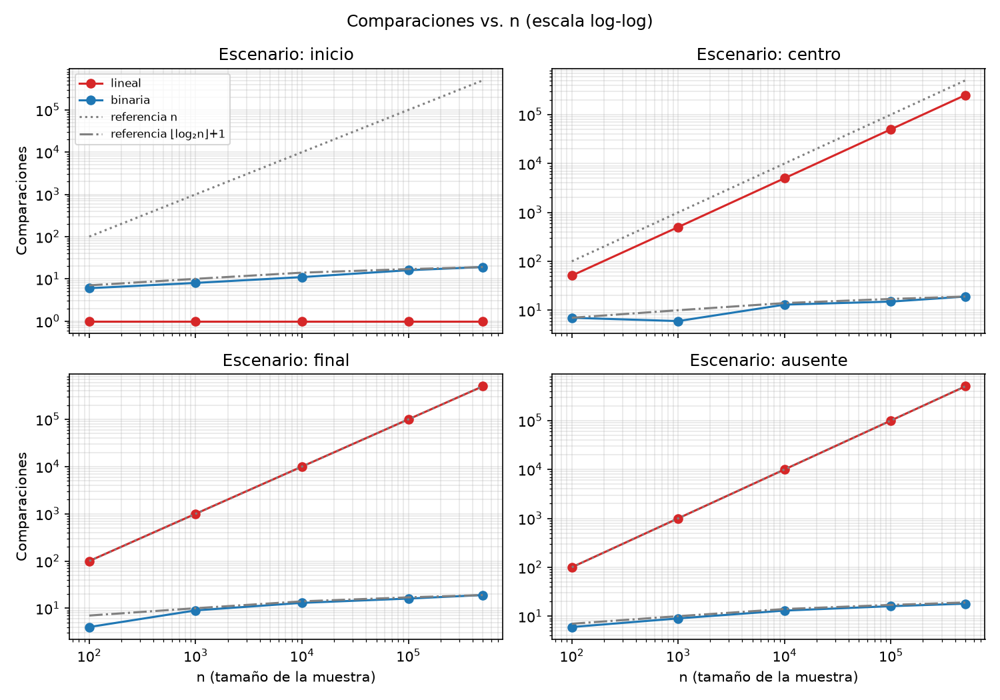
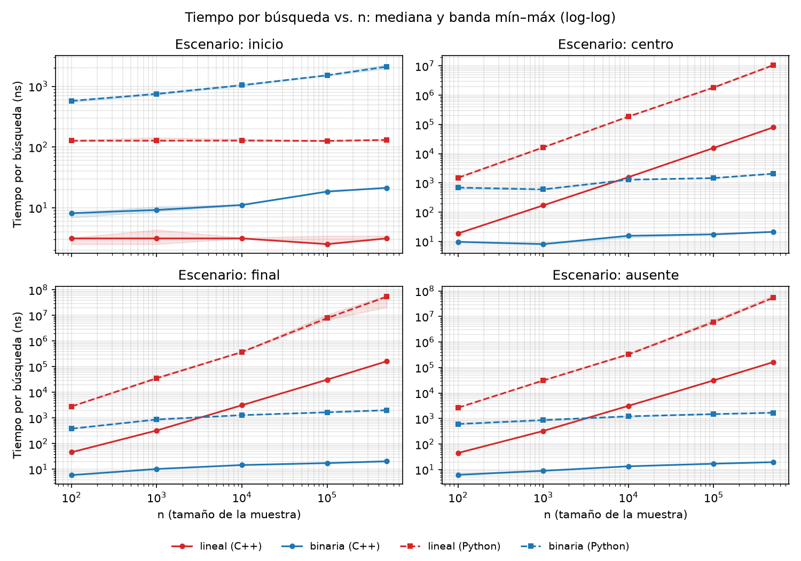
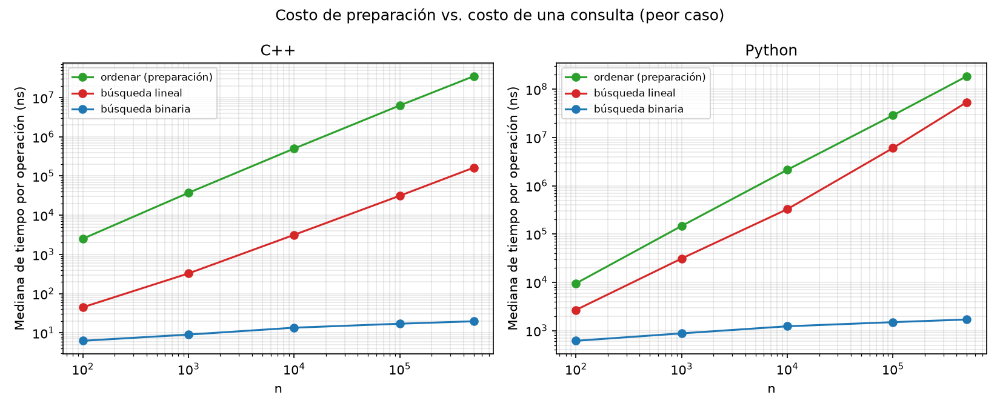
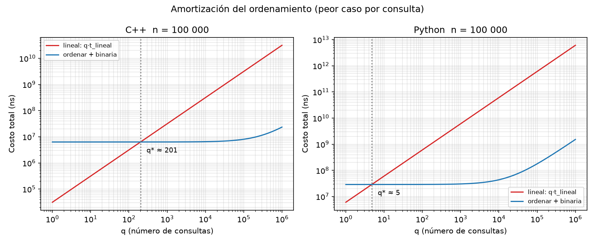

# SIS210 · Algoritmos y Estructuras de Datos — Práctica de laboratorio, Semana 2

**Complejidad algorítmica: búsqueda lineal vs. búsqueda binaria (Python y C++)**

Universidad Nacional del Altiplano · Facultad de Ingeniería Mecánica Eléctrica, Electrónica y Sistemas · Escuela Profesional de Ingeniería de Sistemas · 2026-II

| | |
|---|---|
| Docente | Mg. Aldo Hernán Zanabria Gálvez |
| Estudiantes | Gabriel Tito Quispe | Hanz Fredman Quispe Quispe| Elfer Jaime Machaca Quispe |
| Código | 251211 |
| Experimento | EXP-AED-002 |

## 1. Pregunta del experimento

¿La tendencia empírica de las búsquedas lineal y binaria es consistente con su complejidad teórica cuando aumenta n?

- **Respuesta primaria:** número de comparaciones.
- **Respuesta secundaria:** tiempo por búsqueda (ns).
- Se estudia también el **costo de preparación** (ordenar) y cuántas consultas hacen falta para amortizarlo.

El objetivo no es demostrar que un lenguaje es "mejor", sino contrastar complejidad teórica con evidencia empírica reproducible.

## 2. Estructura del repositorio

```
.
├── README.md
├── requirements.txt
├── cpp/                  Experimento en C++20
│   ├── busqueda.hpp        algoritmos (con y sin contador de comparaciones)
│   ├── datos.hpp           lectura del CSV, claves únicas, muestra reproducible
│   ├── medicion.hpp        cronómetro por bloques y estadísticos
│   └── main.cpp            experimento completo
├── python/               Experimento en Python 3
│   ├── busqueda.py · datos.py · medicion.py · main.py
├── datos/
│   └── convertir_xlsx.py   Online Retail.xlsx -> datos.csv (paso único)
├── analisis/             Tablas y gráficos
│   └── analizar.py · tablas.py · graficos.py
├── resultados/           CSV crudos y resúmenes (+ analisis/: tablas y figuras)
└── docs/
    └── analisis_teorico.md   Hoja de análisis (Fase B)
```

## 3. Requisitos y versiones

| Componente | Requisito | Versión usada |
|---|---|---|
| Python | 3.11 o superior | Python 3.11.9 |
| Paquetes de Python | pip install -r requirements.txt | pandas / matplotlib / numpy |
| Compilador C++ | g++ con soporte C++20 | g++.exe (Rev8, Built by MSYS2 project) 15.2.0 |
| Banderas de C++ | -std=c++20 -O2 | -std=c++20 -O2 |
| Git | cualquiera reciente | git version 2.54.0.windows.1 |
| Sistema operativo | | Windows 11 |
| Procesador / RAM | | Intel(R) Core(TM) i9-14900HX (2.20 GHz)/ 32 GB |

## 4. Dataset y trazabilidad

| | |
|---|---|
| Dataset | Online Retail |
| Repositorio | UCI Machine Learning Repository |
| Instancias | 541 909 transacciones (01/12/2010 – 09/12/2011) |
| DOI | <https://doi.org/10.24432/C5BW33> |
| Licencia | CC BY 4.0 |
| Columna usada | `CustomerID` |

El archivo `Online Retail.xlsx` **no se incluye en el repositorio**: se descarga desde el DOI y se coloca en `datos/` (ver sección 5).

Decisiones sobre los datos:

- **Filas sin `CustomerID`** (~135 000) se codifican como 0 para conservar las 541 909 filas y poder llegar a n = 500 000.
- **Clave única por fila:** `clave = CustomerID × 1 000 000 + número_de_fila`. `CustomerID` tiene solo ~4 300 valores distintos; con claves repetidas, la búsqueda lineal siempre encontraría la primera aparición y los escenarios "centro" y "final" dejarían de serlo.
- **Muestra reproducible:** las claves se ordenan por `splitmix64(clave XOR 42)`, función implementada de forma idéntica en C++ y Python (por eso ambos lenguajes usan exactamente la misma muestra). La muestra de tamaño n es el prefijo de esa permutación, de modo que las muestras son anidadas.

## 5. Cómo reproducir

Los comandos son para PowerShell (Windows); en Linux/macOS son equivalentes.

**1. Clonar e instalar dependencias**

```powershell
git clone <URL-del-repositorio>
cd <carpeta-del-repositorio>
pip install -r requirements.txt
```

**2. Obtener los datos.** Descargue `Online Retail.xlsx` desde <https://doi.org/10.24432/C5BW33>, colóquelo en `datos/` y convierta:

```powershell
cd datos
python convertir_xlsx.py        # genera datos/datos.csv
cd ..
```

**3. Experimento en C++** (ejecutar desde `cpp/`)

```powershell
cd cpp
g++ --version
g++ -std=c++20 -O2 main.cpp -o experimento
.\experimento
cd ..
```

**4. Experimento en Python**

```powershell
python python/main.py
```

**5. Tablas y gráficos**

```powershell
python analisis/analizar.py
```

Salidas en `resultados/`:

| Archivo | Contenido |
|---|---|
| `resultados_crudos_cpp.csv`, `resultados_crudos_python.csv` | una fila por repetición |
| `resultados_resumen_cpp.csv`, `resultados_resumen_python.csv` | promedio, mediana, mínimo y máximo por combinación |
| `analisis/fig1_comparaciones.png` | n vs. comparaciones |
| `analisis/fig2_tiempo.png` | n vs. tiempo |
| `analisis/fig3_preparacion.png` | costo de ordenar vs. costo de una consulta |
| `analisis/fig4_amortizacion.png` | costo total para q consultas y punto de equilibrio q* |
| `analisis/tabla_indicadores.md` | tabla de indicadores de la guía |
| `analisis/tabla_peor_caso.md` | comparaciones y tiempos por n (clave ausente) |
| `analisis/tabla_amortizacion.md` | q* por n y lenguaje |

El tiempo total de ejecución depende de la máquina; la búsqueda lineal en Python con n = 500 000 es la parte más lenta.

## 6. Diseño experimental

| Variable | Operacionalización |
|---|---|
| Tratamiento | Búsqueda lineal (datos sin ordenar) vs. búsqueda binaria (copia ordenada) |
| Tamaño n | 100; 1 000; 10 000; 100 000; 500 000 |
| Escenario | inicio, centro, final y ausente |
| Repeticiones | 30 por combinación (+ 3 bloques de calentamiento no registrados) |
| Control | misma muestra, mismas claves, misma máquina y misma configuración |
| Respuesta primaria | comparaciones (versión con contador, una vez por combinación) |
| Respuesta secundaria | tiempo por búsqueda en ns (versión **sin** contador) |

Control de variables y medición:

- **Carga y ordenamiento fuera del tiempo de búsqueda.** El ordenamiento se mide aparte, como costo de preparación.
- **Medición por bloques.** El reloj del sistema tiene una resolución de ~100 ns en Windows y una búsqueda binaria dura decenas de ns. Cada repetición cronometra K búsquedas seguidas y divide entre K; K se calibra para que el bloque dure al menos ~200 000 ns.
- **Contador separado del cronómetro.** `ops += 1` añade sobrecarga, así que las comparaciones se cuentan en una corrida y el tiempo se mide con la versión sin contador.
- **Corrección verificada** antes de medir: cada búsqueda devuelve la posición correcta (o −1 si la clave está ausente).
- **Ordenamiento:** para n pequeño se ordenan varias copias seguidas, cada una con un orden distinto (si fueran idénticas, el predictor de saltos subestimaría el costo).
- **C++ se compila con `-O2`**; en C++ se usa `std::chrono::steady_clock` y en Python `time.perf_counter_ns()`.

## 7. Resultados

Los resultados completos están en `resultados/`. Figuras (se generan en el paso 5):






Tablas: [indicadores](resultados/analisis/tabla_indicadores.md) · [peor caso](resultados/analisis/tabla_peor_caso.md) · [amortización](resultados/analisis/tabla_amortizacion.md).

## 8. Limitaciones

- **Claves repetidas dentro de cada bloque:** el predictor de saltos y la caché quedan "calientes", así que los tiempos de la búsqueda binaria son optimistas frente a consultas con claves distintas.
- **Escenarios de la binaria:** inicio, centro y final se definen por la posición en la lista desordenada; en la lista ordenada esas claves están en otras posiciones, por lo que no corresponden a posiciones fijas para la binaria.
- **Clave ausente:** `−1` es menor que todas las claves reales, así que la binaria siempre desciende por la izquierda.
- **Amortización:** q* usa el peor caso por consulta (clave ausente); con claves presentes distribuidas de forma uniforme, la lineal tardaría en promedio la mitad.
- **Entorno:** los tiempos dependen de la máquina, el sistema operativo y la carga en el momento de la medición.

## 9. Declaración de uso de IA

> **Borrador: revise y ajuste según lo que realmente hizo.**
>
> Se utilizó Claude (Anthropic) como asistente para organizar el código en módulos (C++ y Python), diseñar el esquema de medición por bloques, generar los scripts de tablas y gráficos, y revisar inconsistencias de la guía de práctica. El estudiante ejecutó los experimentos, verificó los resultados, interpretó los datos y redactó el informe, y es responsable del contenido entregado.

## 10. Referencias (APA 7)

Black, P. E. (2020). *DADS: The on-line dictionary of algorithms and data structures*. National Institute of Standards and Technology. https://www.nist.gov/publications/dads-line-dictionary-algorithms-and-data-structures

Chen, D. (2015). *Online Retail* [Data set]. UCI Machine Learning Repository. https://doi.org/10.24432/C5BW33

cppreference.com. (2026). *Date and time utilities*. https://en.cppreference.com/w/cpp/chrono

Cormen, T. H., Leiserson, C. E., Rivest, R. L., & Stein, C. (2022). *Introduction to algorithms* (4th ed.). MIT Press. https://mitpress.mit.edu/9780262046305/introduction-to-algorithms/

Python Software Foundation. (2026). *time — Time access and conversions*. Python 3.14.7 documentation. https://docs.python.org/3/library/time.html

Skiena, S. S. (2020). *The algorithm design manual* (3rd ed.). Springer. https://link.springer.com/book/10.1007/978-3-030-54256-6
